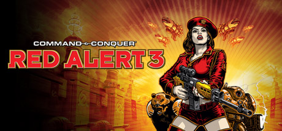

**Command & Conquer: Red Alert 3 is the most colorful entry featuring three factions including the new Empire of the Rising Sun with anime-inspired transforming units. Features mandatory co-op campaigns and an entertaining live-action FMV story.**

---

## 📖 About

Command & Conquer: Red Alert 3 is the most colorful entry featuring three factions including the new Empire of the Rising Sun with anime-inspired transforming units. Features mandatory co-op campaigns and an entertaining live-action FMV story.

## ⚠️ Problems Without Trainer

| Problem | Status |
|---------|--------|
| **Empire Transformation Micro** — Imperial units transforming mid-combat requires constant attention | ✅ Solved |
| **Co-op Campaign Design** — Single-player campaign is notably harder than intended without a partner | ✅ Solved |
| **Premier Edition Content** — Some units only available in premium editions | ✅ Solved |
| **Base Defense Gapping** — Defending large bases against three-faction assaults is micromanagement-intensive | ✅ Solved |

## ✅ Solution

The **Command & Conquer: Red Alert 3 Trainer** solves all these issues by giving you complete control over the game.

## 🎯 Full Feature List

- Unlimited Resources
- God Mode / Invincibility
- Instant Skill Cooldown
- One-Hit Kill
- Freeze Game Timer
- Unlock All Items & Achievements
- Custom Speed Multiplier
- Save State Anywhere

## 🚀 Quick Start

1. **Disable Windows Defender** temporarily (trainer may trigger false positive)
2. Download the trainer from the button above
3. Launch Command & Conquer: Red Alert 3
4. Run the trainer as Administrator
5. Activate desired cheats with hotkeys

## 💎 Free vs Paid

| Feature | Free | Pro |
|---------|------|-----|
| Basic God Mode | ✅ | ✅ |
| Unlimited Resources | ✅ | ✅ |
| All Advanced Cheats | ❌ | ✅ |
| Auto-Updates | ❌ | ✅ |
| Priority Support | ❌ | ✅ |

## 💻 Requirements

- Windows 10/11 (64-bit)
- Command & Conquer: Red Alert 3 (any version)
- .NET Framework 4.8+
- DirectX 11+

## 🍎 macOS

macOS users can use our alternative tool:

## ⚖️ Legal

This trainer is for educational and single-player use only. Use responsibly.

---

